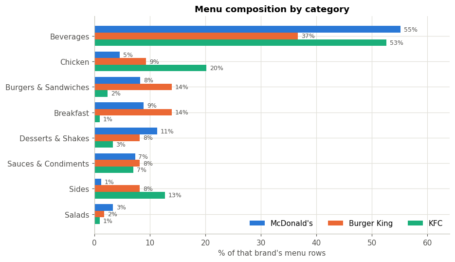
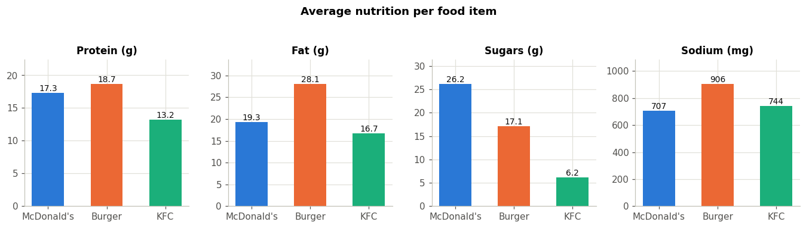

# Fast-Food Product & Nutrition Analytics
### McDonald's vs Burger King vs KFC

**Project owner and author: Pranit Ajay Chaudhari** — first-year BBA student (Marketing and Finance, with
Python and SQL as technical skills). This is Project 2 of my analytics portfolio.

> **713 menu items · 420 distinct products · 3 brands · 8 categories · Python, MySQL and Excel**
> McDonald's carries **184 distinct products** against 123 at KFC and 113 at Burger King ·
> Burger King's food averages **507.5 kcal** per item against KFC's 311.9 ·
> KFC's food is the most protein-dense per calorie (**4.55 g/100 kcal**) and the most sodium-dense (**235 mg/100 kcal**) ·
> The average drink carries **38.2 g of sugar**



---

## 1. Business problem

Three global fast-food chains compete for the same customer, and each publishes a full nutrition breakdown
of its menu. Read properly, that published data says a lot about **strategy**: how wide a range each brand
carries, which categories it concentrates on, how indulgent its food is, and where it is exposed to sugar
and sodium pressure.

The question this project answers: **what does each brand's menu reveal about how it is positioned, and
what would a marketing or category manager do about it?**

## 2. Objectives

1. Build one clean, comparable menu dataset from a messy public source.
2. Measure portfolio size and shape for each brand — honestly, without letting cup sizes inflate the count.
3. Compare the three menus on nutrition in a way that is not distorted by portion size.
4. Turn the comparison into positioning and category conclusions a business reader can act on.
5. Deliver a reproducible analysis in Python, SQL and Excel, with the core numbers agreeing across the tools.

## 3. Dataset and source

| | |
|---|---|
| **File** | `data/raw/fastfood_nutrition_menu_v3_source.csv` (1,147 rows × 14 columns) |
| **Underlying source** | Nutrition data compiled from **fastfoodnutrition.org**, which republishes the chains' own published nutrition information |
| **Obtained from** | Public GitHub repository `tturne21/Capstone` |
| **Date obtained** | 30 September 2026 |
| **SHA-256** | `20ac70d3d580f44c0326d6a7095f5dae289577e0bd9d06795741984d793caa62` |
| **Market** | United States |
| **Vintage** | Snapshot of roughly **2010–2013** (it contains discontinued items such as the Triple Thick Shake and Angus burgers) |

Full provenance: [`data/raw/README.md`](data/raw/README.md).

## 4. Data limitations — please read these first

1. **Historical, not current.** This describes these menus as they were around 2010–2013. No claim is made about today's menus.
2. **US menus only.** Nothing transfers to India, where none of the three sells beef.
3. **Third-party compilation.** The compiler and exact collection date are not documented. The figures match what the chains published at the time but are not brand-certified.
4. **No prices.** Menu prices are not published as open data by any of the three brands; the only sources carrying them are paid commercial scrapers. **No prices were invented.** A template for collecting them first-hand ships with the project — see [`docs/PRICE_COLLECTION_GUIDE.md`](docs/PRICE_COLLECTION_GUIDE.md) — and the pricing analysis will be added once that data exists.
5. **No serving sizes**, so per-item comparisons mix a chicken wing with a triple burger. This is exactly why the analysis leans on per-100-kcal ratios.
6. **Menu rows are not products.** Each cup size is its own row; the cleaning step derives a base product so range can be counted honestly.

## 5. Tools used

| Tool | What it does here |
|---|---|
| **Python** (pandas, numpy, matplotlib, openpyxl) | Cleaning, the whole analysis, the charts, and generation of the Excel workbook |
| **MySQL / MariaDB** | Relational schema with a category lookup, plus 14 business queries using CTEs, window functions, `CASE` and joins |
| **Excel** | A formula-driven workbook (1,638 formulas, 0 errors) that recalculates the analysis itself |

## 6. Data cleaning

1,147 raw rows → **713 clean menu items**, with no missing nutrition values. The interesting part is that this
source had real structural damage, not just typos:

| Step | Rows | What happened |
|---|---|---|
| Kept the 3 brands | 736 | Other chains out of scope; McDonald's curly apostrophe standardised |
| **Repaired Burger King's drinks** | 736 | 42 rows were named only "16 fl oz" — the drink name sat in a separate header row above them. Re-attaching the parent name recovered 42 real products |
| Dropped empty header rows | 725 | 11 drink names carrying no nutrition |
| Numeric conversion | 725 | 17 values were `<5` mg or `<1` g — set to 0, as US labelling rules allow |
| Dropped 2 columns | 725 | *Calories from Fat* (30% missing, derivable) and *Weight Watchers Pnts* (proprietary, not a nutrition fact) |
| Removed duplicates | **713** | 12 products listed twice |
| Derived category | 713 | 8 categories, 0 uncategorised |

Full detail and the reasoning behind every rule: [`docs/DATA_CLEANING.md`](docs/DATA_CLEANING.md).

## 7. Python analysis

`python/02_analysis.py` produces the summary tables every other tool checks against, plus eight charts in
`screenshots/`. The method decision that shapes everything: **beverages are 356 of the 713 rows**, so all
nutrition averages use **food items only** (304 items), and portfolio size is reported as distinct products
as well as menu rows.



## 8. SQL analysis

`sql/` contains the schema (`menu_items` + a `categories` lookup with the food/non-food flag), the import
script, and **14 business queries** — portfolio size, menu composition, calorie averages and ranges,
category nutrition profiles, highest and lightest items, protein efficiency, calorie bands, drink sugar,
items pulling a brand's average up, category breadth, and a core-category comparison. Outputs are saved in
`sql/query_results/`. See [`sql/README.md`](sql/README.md).

## 9. Excel analysis

`excel/FastFood_Product_Nutrition_Analysis.xlsx` — nine sheets, 1,638 formulas, 0 errors. If you
regenerate it with `python/03_build_excel.py`, open and save it once in Excel before committing:
openpyxl writes formulas but cannot evaluate them, and GitHub's preview shows a blank grid without
cached values. Nine sheets. `Clean_Data` holds the 713 items and every
summary sheet is COUNTIFS / AVERAGEIFS / SUMIFS on top of it, so the workbook recalculates itself rather
than storing pasted results. Two helper columns do the work that makes it honest: `IsFood` (looked up from
`Category_Lookup`) and `IsFirstOfBaseProduct` (so distinct products can be counted without a pivot).

## 10. Key findings

| Brand | Distinct products | Avg calories (food) | Protein /100 kcal | Sodium /100 kcal | % food 800 kcal+ |
|---|---|---|---|---|---|
| McDonald's | **184** | 458.1 | 3.92 | 163.7 | 8.1% |
| Burger King | 113 | **507.5** | 3.31 | 175.3 | **13.7%** |
| KFC | 123 | 311.9 | **4.55** | **235.2** | 3.5% |

1. **Menu breadth is McDonald's structural difference** — 184 distinct products, about 50% more than KFC and 63% more than Burger King. Breadth buys occasions but costs operational complexity.
2. **Burger King's food is the most calorie-dense, KFC's the least — but that is portion structure, not health.** KFC sells individual chicken pieces; Burger King sells composed sandwiches. Per-item calories compare packaging, not diets.
3. **Per calorie, KFC is both the most protein-dense and the most sodium-dense.** Both are real and they point in opposite marketing directions.
4. **Sugar is a drinks problem**: the average beverage carries 38.2 g, and drinks are half of all menu rows.
5. **Sodium concentrates in breakfast (1,107 mg) and burgers (1,084 mg)** — about half an adult's daily recommendation in one item.
6. **The light-end range barely exists**: salads are 16 items across all three brands, 2.2% of the menu.

Full numbers: [`RESULTS.md`](RESULTS.md).

## 11. Business and marketing implications

| Finding | What a manager could do | Why |
|---|---|---|
| McDonald's 184-product range | Pair with item-level sales and prune the long tail | Breadth only pays if the extra items sell; this data cannot tell you that, so the recommendation is to go and check |
| KFC's protein density (4.55 g/100 kcal) | Lead with protein in KFC's positioning | The menu structure genuinely supports the claim — 20% of its rows are chicken |
| KFC's sodium density (235 mg/100 kcal) | Prioritise sodium reformulation | It is the flip side of the same fried-chicken menu and the clearest regulatory exposure |
| 38.2 g sugar per drink | Push the zero-sugar range on price and placement | 56 zero-calorie items already exist; the range is there, the mix is the problem |
| Breakfast at 1,107 mg sodium | Reformulate breakfast first | It is the saltiest category of all, and a smaller, newer daypart where change is less visible to loyal customers |
| 16 salads across three brands | Either build the light range or stop advertising it | Every brand tells a health story it has almost no product range to support |

Full reasoning: [`docs/BUSINESS_INSIGHTS.md`](docs/BUSINESS_INSIGHTS.md).

## 12. Project structure

```
Project-2-Fast-Food-Analytics/
├── README.md · RESULTS.md · RESUME_BULLETS.md · LICENSE · requirements.txt · run_all.sh
├── data/
│   ├── raw/          fastfood_nutrition_menu_v3_source.csv, price_collection_template.csv, README.md
│   └── cleaned/      menu_clean.csv (713 items), cleaning_log.csv, brand_summary.csv,
│                     brand_category_summary.csv, category_summary.csv, nutrition_by_brand.csv,
│                     kpis.csv, top_calorie_items.csv, top_sodium_items.csv,
│                     top_protein_efficiency_items.csv, uncategorised.csv (empty)
├── python/
│   ├── 01_clean_data.py              cleaning with a full audit log
│   ├── 02_analysis.py                summary tables + 8 charts
│   ├── 03_build_excel.py             the Excel workbook
│   └── run_sql_queries.py            runs the SQL project and exports results
├── sql/
│   ├── 01_create_schema.sql · 02_import_data.sql · 03_business_queries.sql · README.md
│   └── query_results/                q01 … q14 CSV outputs
├── excel/FastFood_Product_Nutrition_Analysis.xlsx
├── docs/
│   ├── DATA_CLEANING.md · BUSINESS_INSIGHTS.md · VERIFICATION.md · PRICE_COLLECTION_GUIDE.md
└── screenshots/                      8 analysis charts
```

## 13. How to reproduce

```bash
git clone https://github.com/<your-username>/Project-2-Fast-Food-Analytics.git
cd Project-2-Fast-Food-Analytics
pip install -r requirements.txt

python python/01_clean_data.py             # 1,147 raw rows -> 713 clean items, prints the audit log
python python/02_analysis.py               # summary tables + charts
python python/03_build_excel.py            # Excel workbook

# SQL (needs MySQL 8 or MariaDB):
python python/run_sql_queries.py --user root --password "..."
```

`run_all.sh` chains the Python steps. The whole pipeline runs in about a minute.

## 14. Verification

Python, MySQL and Excel were checked against each other rather than assumed to agree: **39 of 39
brand metrics identical across Python and SQL**, with the Excel workbook independently checked for its
summary calculations. The project also underwent an independent audit that identified and fixed data-cleaning,
product-counting and Excel-reference issues in the code/workbook. Details: [`docs/VERIFICATION.md`](docs/VERIFICATION.md).

## 15. Limitations

Historical US menus (c. 2010–2013); no prices, sales, serving sizes or profitability; categories are
derived from item names by a documented rule set rather than supplied by the brands.

## 16. Future improvements

1. **Add pricing** from the first-hand collection template, giving price-per-100-kcal value analysis and a true value-for-money comparison.
2. **Refresh to current menus** by collecting today's published nutrition data, enabling a then-versus-now reformulation analysis.
3. **Add the India menus** to make the project locally relevant, including the vegetarian range that does not exist in the US data.
4. **Bring in sales or traffic data** so menu breadth can be judged on what it earns rather than on how long it is.

---

**Author: Pranit Ajay Chaudhari**
